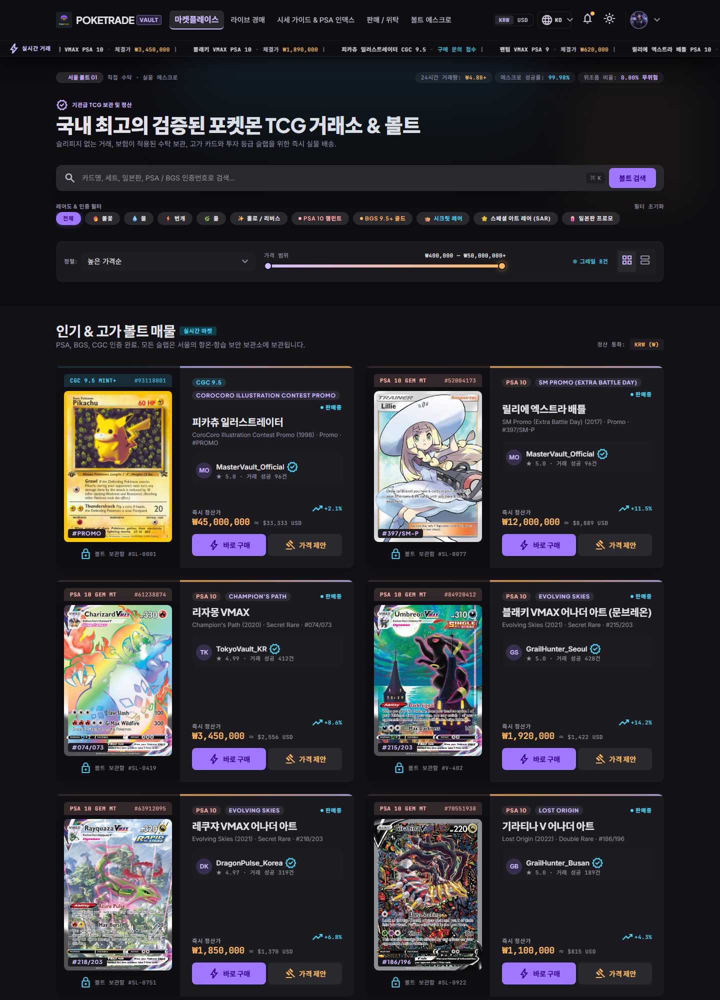
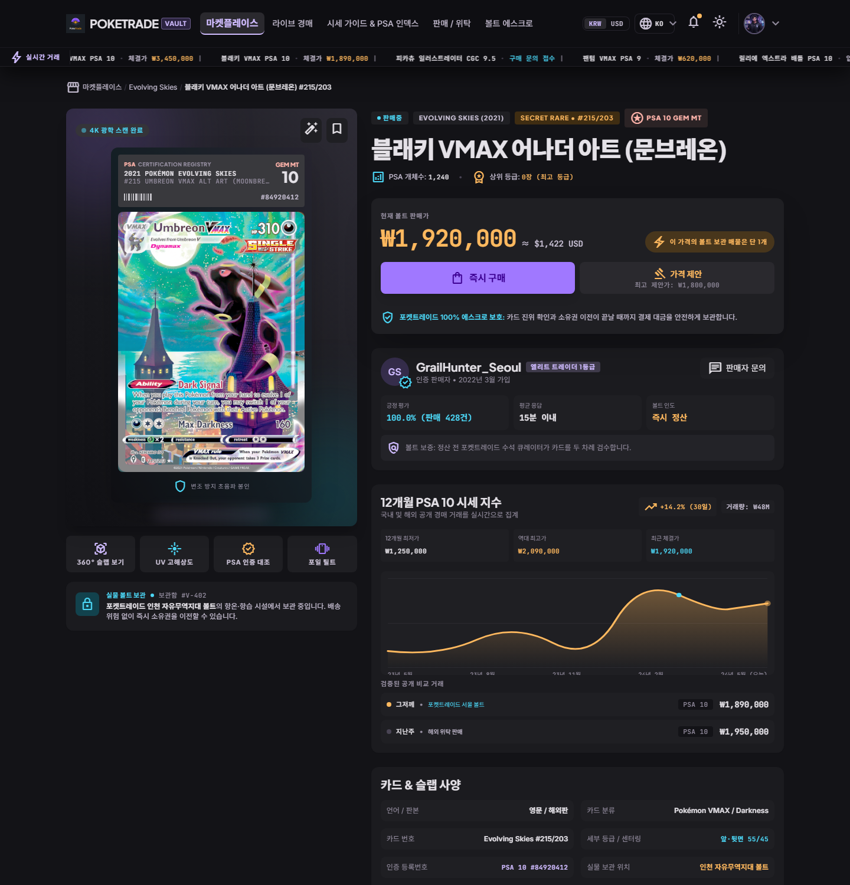
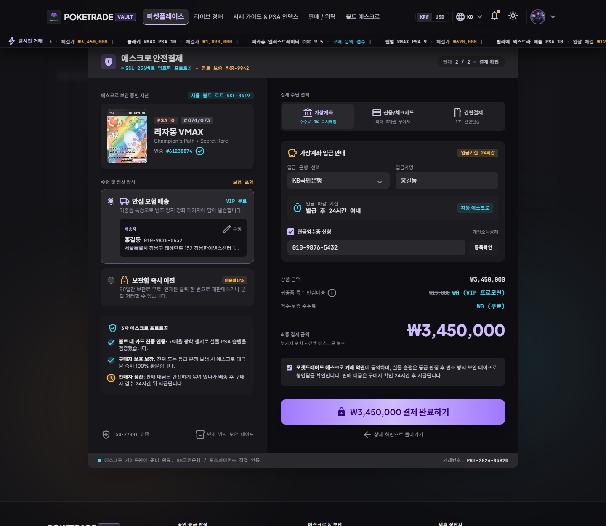
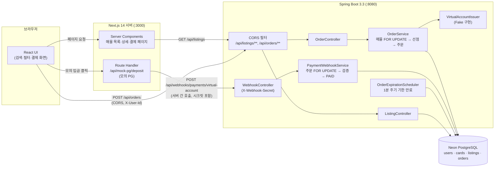
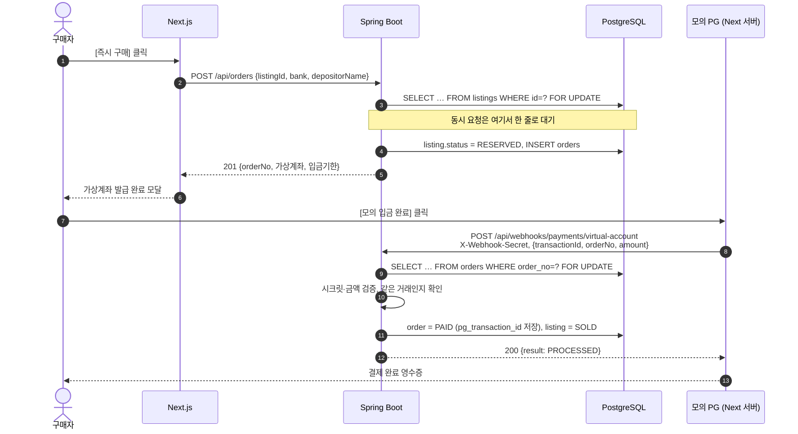
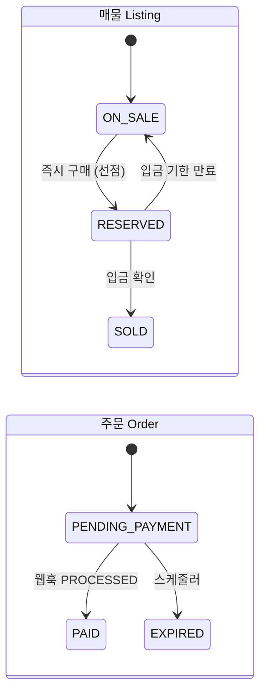
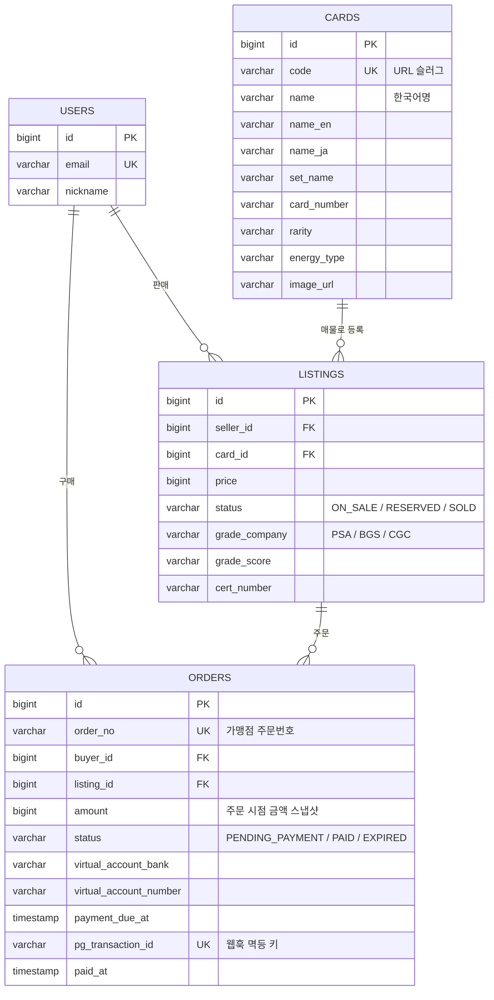
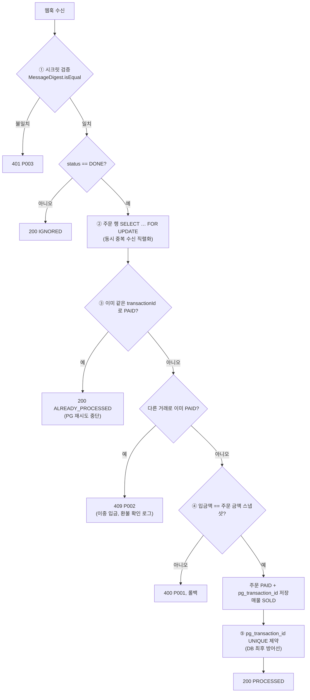

<div align="center">

# PokeTrade Vault

**감정(그레이딩) 포켓몬 카드 C2C 에스크로 마켓플레이스**

1장뿐인 실물 카드를 여러 명이 동시에 사려 할 때도 **단 한 명만** 구매에 성공하고,<br>
PG 입금 통보가 몇 번 다시 와도 **결제는 정확히 한 번만** 반영되도록 설계했습니다.


</div>

<p align="center">
  
  
  
</p>
<p align="center"><sub>마켓플레이스 · 카드 상세 · 에스크로 결제 (실제 실행 화면)</sub></p>

---

## 목차

1. [프로젝트 소개](#1-프로젝트-소개)
2. [기술 스택](#2-기술-스택)
3. [시스템 아키텍처](#3-시스템-아키텍처)
4. [핵심 문제 해결 ① 비관적 락으로 1장 한정 매물 동시성 제어](#4-핵심-문제-해결--비관적-락으로-1장-한정-매물-동시성-제어)
5. [핵심 문제 해결 ② 가상계좌 웹훅 멱등성 보장](#5-핵심-문제-해결--가상계좌-웹훅-멱등성-보장)
6. [그 밖의 설계 고민](#6-그-밖의-설계-고민)
7. [테스트](#7-테스트)
8. [실행 방법](#8-실행-방법)
9. [API 명세](#9-api-명세)
10. [한계와 개선 계획](#10-한계와-개선-계획)

---

## 1. 프로젝트 소개

감정 슬랩(PSA·BGS·CGC)에 담긴 고가 카드는 **같은 카드가 세상에 하나뿐인 재고 1개짜리 상품**입니다. 그리고 국내 C2C 거래에서 흔한 **가상계좌 결제는 비동기**입니다. 주문 시점에는 계좌만 발급되고, 실제 입금 확인은 나중에 PG사 웹훅으로 들어옵니다.

이 두 가지 특성 때문에 일반 쇼핑몰보다 정합성 요구가 까다롭습니다.

| 상황 | 막지 못하면 생기는 일 |
| --- | --- |
| 인기 카드에 구매 요청이 동시에 몰림 | 1장뿐인 카드가 두 명에게 팔림 (이중 판매) |
| PG가 같은 입금 통보를 재전송하거나 동시에 보냄 | 결제·소유권 이전이 두 번 반영됨 |
| 입금액이 주문 금액과 다르거나 위조된 웹훅이 들어옴 | 덜 낸 돈으로 카드가 넘어감 |
| 입금 기한 만료와 입금 통보가 같은 순간에 처리됨 | 만료된 주문이 결제되거나, 결제된 매물이 다시 판매됨 |

PokeTrade는 이 문제들을 **DB 트랜잭션과 행 잠금**으로 막는 백엔드와, 실제 서비스 수준의 화면을 갖춘 프론트엔드로 구성된 풀스택 프로젝트입니다.

### 주요 기능

- **즉시 구매**: 매물 선점(재고 홀드) → 주문 생성 → 가상계좌 발급(은행·입금자명 선택), 입금 기한 24시간
- **입금 웹훅 처리**: 시크릿 검증 → 금액 검증 → 중복 수신 방지 → 주문 `PAID`, 매물 `SOLD`
- **기한 만료 처리**: 스케줄러가 1분마다 기한이 지난 주문을 만료시키고 매물을 다시 판매중으로 되돌림
- **마켓플레이스 UI**: 실시간 검색, 속성·등급·레어도 필터, 가격 범위 이중 슬라이더, 정렬
- **결제 시뮬레이터**: 실제 PG 대신 Next.js 서버가 PG 역할을 맡아 백엔드에 입금 웹훅을 보냄
- **다국어·통화·테마**: 한국어/English/日本語, KRW/USD 환산, 다크/라이트 모드
- **데모(오프라인) 모드**: 백엔드에 연결할 수 없으면(예: 프론트만 Vercel에 배포) 차단 화면 대신 [Pokémon TCG API](https://pokemontcg.io)의 실제 카드 50장에 시세·감정 등급·판매자를 자동으로 붙여 마켓을 채웁니다(1시간 캐시). API 마저 실패하면 내장 데모 매물 8건을 씁니다. 결제는 브라우저 안에서 시뮬레이션하고, 화면 우측 상단에 `● 데모 모드 (오프라인)` 뱃지만 표시됩니다.

---

## 2. 기술 스택

| 영역 | 기술 | 선택 이유 |
| --- | --- | --- |
| Backend | **Java 17**, **Spring Boot 3.3** | DTO 를 record 로 간결하게 표현, Jakarta EE 기반의 안정적인 LTS 조합 |
| ORM | **Spring Data JPA** (Hibernate 6) | `@Lock(PESSIMISTIC_WRITE)`로 행 잠금을 선언적으로 표현, Auditing으로 생성·수정 시각 자동 기록 |
| Database | **Neon PostgreSQL** | 서버리스 PostgreSQL. `SELECT … FOR UPDATE` 행 잠금과 unique 제약을 그대로 활용 |
| 테스트 DB | H2 (MySQL 모드) | 외부 DB 없이 동시성·웹훅 통합 테스트를 빠르게 실행 |
| API 문서 | springdoc-openapi (Swagger UI) | 컨트롤러 어노테이션에서 API 문서 자동 생성 |
| Frontend | **Next.js 14** (App Router), React 18, **TypeScript** | 서버 컴포넌트로 매물을 요청마다 새로 조회하고, Route Handler로 모의 PG를 같은 프로젝트에 구성 |
| Styling | Tailwind CSS 3 | CSS 변수 기반 디자인 토큰으로 다크/라이트 테마 전환 |
| Build | Gradle 8.10, npm | |

---

## 3. 시스템 아키텍처



- **조회**는 Next.js 서버 컴포넌트가 요청마다 백엔드를 호출합니다. 결제 직후 바뀐 재고 상태가 바로 보이도록 클라이언트 라우터 캐시도 끕니다.
- **주문**은 브라우저가 백엔드를 직접 호출합니다. CORS는 브라우저용 경로(`/api/listings/**`, `/api/orders/**`)에만 엽니다.
- **웹훅**은 서버 간 호출입니다. 웹훅 시크릿이 브라우저 번들에 노출되지 않도록, 모의 PG 역할을 Next.js 서버 라우트가 맡고 웹훅 경로는 CORS 대상에서 뺐습니다.

### 결제 시퀀스



### 상태 전이



상태 전이 규칙은 엔티티 메서드(`Listing.reserve()`, `Order.completePayment()`, `Order.expire()`)에만 있습니다. 허용되지 않은 전이를 시도하면 예외가 발생하므로 서비스 계층에서 상태를 임의로 바꿀 수 없습니다.

### ERD



---

## 4. 핵심 문제 해결 ① 비관적 락으로 1장 한정 매물 동시성 제어

### 문제

같은 매물에 구매 요청 두 개가 거의 동시에 들어오면, 두 트랜잭션이 모두 `status = ON_SALE`을 읽고 각자 주문을 만듭니다. 그 결과 카드는 1장인데 주문과 가상계좌가 2개 생깁니다. 전형적인 **Lost Update / Check-then-Act 경합**입니다.

```
T1: SELECT status → ON_SALE ─┐
T2: SELECT status → ON_SALE ─┤  둘 다 "살 수 있음"으로 판단
T1: UPDATE RESERVED, INSERT order
T2: UPDATE RESERVED, INSERT order   ← 이중 판매
```

### 검토한 방법

| 방법 | 장점 | 단점 | 판단 |
| --- | --- | --- | --- |
| 낙관적 락 (`@Version`) | 잠금 대기가 없음 | 충돌을 **커밋 시점**에야 알기 때문에, 진 쪽은 주문 생성·가상계좌 발급까지 한 뒤 롤백됨. 인기 매물일수록 낭비가 큼 | ✕ |
| 조건부 UPDATE (`UPDATE … WHERE status='ON_SALE'`) | 가장 가벼움 | 상태 전이 규칙이 엔티티 밖 쿼리로 흩어짐. 영향받은 행 수로 성공 여부를 판단해야 함 | △ (대안) |
| Redis 분산 락 | DB 밖에서 제어, 여러 DB에 걸친 잠금 가능 | 인프라 추가, 락 만료와 트랜잭션 경계를 따로 맞춰야 함. 단일 DB 정합성 문제에는 과함 | ✕ |
| **비관적 락 (`SELECT … FOR UPDATE`)** | 진입 시점에 요청을 한 줄로 세움. 진 쪽은 바뀐 상태를 읽고 **즉시** 실패 | 대기 중인 커넥션이 묶임 | ✅ 채택 |

재고가 항상 1개라 경합 시 **성공자는 무조건 한 명**입니다. 따라서 "모두 시도시키고 나중에 실패시키는" 낙관적 방식보다, **처음부터 줄을 세우고 나머지는 빨리 돌려보내는** 비관적 락이 맞다고 판단했습니다. 트랜잭션이 짧아(매물 선점과 주문 INSERT만 수행) 대기 시간도 작습니다.

### 구현

```java
// ListingRepository.java
@Lock(LockModeType.PESSIMISTIC_WRITE)
@QueryHints(@QueryHint(name = "jakarta.persistence.lock.timeout", value = "3000"))
@Query("select l from Listing l where l.id = :id")
Optional<Listing> findByIdForUpdate(@Param("id") Long id);
```

```java
// OrderService.java
@Transactional
public OrderResponse placeOrder(Long buyerId, Long listingId, VirtualAccountBank bank, String depositorName) {
    User buyer = userRepository.findById(buyerId).orElseThrow(...);

    // ① 매물 행 잠금. 뒤따르는 트랜잭션은 앞선 트랜잭션이 커밋할 때까지 여기서 대기
    Listing listing = listingRepository.findByIdForUpdate(listingId).orElseThrow(...);
    if (listing.isSoldBy(buyerId)) throw new BusinessException(SELF_PURCHASE_NOT_ALLOWED);

    // ② ON_SALE 일 때만 RESERVED 로 전이. 대기하던 요청은 바뀐 상태(RESERVED)를 읽고 L002 로 실패
    listing.reserve();

    // ③ 금액 스냅샷을 담은 주문 생성 + 가상계좌 발급
    Order order = orderRepository.save(Order.create(buyer, listing, dueAt));
    ...
}
```

```java
// Listing.java: 상태 전이 규칙은 엔티티가 보장
public void reserve() {
    if (status != ListingStatus.ON_SALE) {
        throw new BusinessException(ErrorCode.LISTING_NOT_AVAILABLE); // 409, L002
    }
    this.status = ListingStatus.RESERVED;
}
```

- 실패한 요청은 `409 { code: "L002" }`로 응답합니다. 프론트는 "방금 다른 구매자가 먼저 구매해 결제할 수 없습니다"를 보여 줍니다.
- 잠금 대기 중 타임아웃 등 `PessimisticLockingFailureException`이 나면 전역 예외 처리기가 `409 C002`(잠시 후 다시 시도)로 바꿔 응답합니다.

### 검증

[`OrderConcurrencyTest`](src/test/java/com/pocket/market/service/OrderConcurrencyTest.java)에서 **서로 다른 구매자 20명**이 `CountDownLatch`로 같은 순간에 출발해 같은 매물을 주문합니다.

| 검증 항목 | 결과 |
| --- | --- |
| 성공한 주문 | **1건** |
| 실패한 주문 | 19건, 모두 `LISTING_NOT_AVAILABLE` |
| 생성된 주문 행 수 | 1 |
| 최종 매물 상태 | `RESERVED` |

화면에서도 같은 상황을 확인했습니다. 구매자 A가 결제 화면을 열어 둔 사이 다른 사용자가 API로 먼저 주문하자, A의 결제 버튼은 `409 L002` 안내를 보여 줬습니다.

---

## 5. 핵심 문제 해결 ② 가상계좌 웹훅 멱등성 보장

### 문제

PG 웹훅은 보통 **at-least-once**로 전달됩니다. 가맹점 응답이 늦거나 네트워크가 끊기면 PG는 **같은 입금 통보를 다시 보내고**, 재전송이 원래 요청과 **동시에** 도착하기도 합니다. 웹훅 엔드포인트가 외부에 열려 있으므로 **위조 요청**이나 **금액이 다른 통보**도 막아야 합니다.

### 해결: 겹겹이 막는 방어



| 계층 | 방법 | 막는 것 |
| --- | --- | --- |
| ① 인증 | 공유 시크릿을 `MessageDigest.isEqual`로 상수 시간 비교 | 위조 웹훅, 타이밍 공격 |
| ② 직렬화 | **주문 행 비관적 락**(`findByOrderNoForUpdate`) | 같은 통보가 동시에 도착하는 경우 |
| ③ 멱등 응답 | 같은 `transactionId`로 이미 결제됐으면 상태를 바꾸지 않고 **200 `ALREADY_PROCESSED`** | PG 재전송. 5xx를 돌려주면 PG가 계속 재시도하므로 성공으로 응답 |
| ④ 금액 검증 | 주문 생성 시 저장한 **금액 스냅샷**과 입금액 비교 | 금액 위변조, 매물 가격 변경 후 입금 |
| ⑤ DB 제약 | `orders.pg_transaction_id`에 UNIQUE 제약 | 애플리케이션 로직이 뚫려도 같은 거래의 이중 반영 차단 |
| ⑥ 비밀 관리 | 시크릿은 서버 환경변수에만 둠. 모의 PG도 Next.js **서버** 라우트에서 호출 | 브라우저 번들을 통한 시크릿 유출 |

```java
// PaymentWebhookService.java (요약)
@Transactional
public WebhookResponse handleVirtualAccountDeposit(String secret, VirtualAccountDepositWebhookRequest request) {
    verifySecret(secret);                                            // ①
    if (request.status() != DepositStatus.DONE) return of(IGNORED, request.orderNo());

    Order order = orderRepository.findByOrderNoForUpdate(request.orderNo())   // ②
            .orElseThrow(() -> new BusinessException(ErrorCode.ORDER_NOT_FOUND));

    if (order.isPaidWith(request.transactionId())) {                 // ③ 같은 거래 재수신
        return of(ALREADY_PROCESSED, order.getOrderNo());
    }
    if (order.getStatus() == OrderStatus.PAID) {                     // 다른 거래로 이미 결제됨
        throw new BusinessException(ErrorCode.DUPLICATE_TRANSACTION);
    }
    if (order.getStatus() != OrderStatus.PENDING_PAYMENT) {          // 만료된 주문 등
        throw new BusinessException(ErrorCode.INVALID_ORDER_STATE);
    }
    order.completePayment(request.amount(), request.transactionId(), paidAt); // ④ 금액 검증 + PAID + SOLD
    return of(PROCESSED, order.getOrderNo());
}
```

### 검증

[`PaymentWebhookServiceTest`](src/test/java/com/pocket/market/service/PaymentWebhookServiceTest.java)

| 시나리오 | 기대 결과 |
| --- | --- |
| 정상 입금 통보 | 주문 `PAID`, 매물 `SOLD` |
| 같은 웹훅 재수신 | `ALREADY_PROCESSED`, 상태 변화 없음 |
| **같은 웹훅 8개가 동시에 도착** | `PROCESSED` **1건** + `ALREADY_PROCESSED` 7건, 예외 0건, 매물 `SOLD` |
| 입금액 ≠ 주문 금액 | `P001`로 거부, 주문은 `PENDING_PAYMENT` 유지 |
| 이미 결제된 주문에 다른 거래 ID | `P002 DUPLICATE_TRANSACTION` |
| 시크릿 불일치 | `P003 INVALID_WEBHOOK_SIGNATURE` |

---

## 6. 그 밖의 설계 고민

- **기한 만료와 입금 통보의 경합**
  - 스케줄러는 만료 대상 주문 ID만 먼저 조회합니다.
  - 그다음 주문을 하나씩 `FOR UPDATE`로 잠근 뒤 상태와 기한을 **다시 확인**하고 만료시킵니다.
  - 웹훅도 같은 주문 행을 잠그므로 둘 중 하나만 반영됩니다.
- **잠금 순서와 교착 상태 방지**
  - 웹훅과 만료 처리는 모두 *주문 행 → 매물 행* 순서로 잠급니다.
  - 즉시 구매는 매물 행만 잠그고 기존 주문 행은 잠그지 않습니다.
  - 따라서 잠금 대기가 순환하지 않습니다.
- **금액 스냅샷**
  - 주문 금액은 주문 시점의 매물 가격을 복사해 저장합니다.
  - 결제 대기 중 매물 가격이 바뀌더라도(향후 가격 수정 기능 추가 시) 입금 검증 기준은 흔들리지 않습니다.
- **CORS 최소 개방**
  - 브라우저가 부르는 매물·주문 API만 열고, 허용 출처는 설정값(`app.cors.allowed-origin-patterns`)으로 관리합니다.
  - 웹훅 경로는 브라우저 출처의 preflight를 거부하며, 이를 테스트로 확인합니다.
- **영속 DB 운영**
  - Neon 접속 정보는 Git에 올리지 않는 `.env.properties`에서 읽습니다.
  - 재시작해도 데이터가 지워지지 않도록 `ddl-auto: update`를 쓰고, 시드 데이터는 DB가 비어 있을 때만 넣습니다.
- **프론트 데이터 원천 단일화**
  - 카드명(3개 언어)·세트·등급·인증번호·가격·재고 상태는 모두 백엔드 응답에서 가져옵니다.
  - 프론트에는 아직 API가 없는 부가 시세 정보만 분리해 둡니다.

---

## 7. 테스트

```bash
./gradlew test
```

| 테스트 클래스 | 개수 | 내용 |
| --- | --- | --- |
| `OrderConcurrencyTest` | 1 | 20명 동시 주문 시 1건만 성공 |
| `PaymentWebhookServiceTest` | 6 | 멱등성, 동시 중복 수신, 금액 검증, 이중 결제, 시크릿 검증 |
| `CorsConfigTest` | 4 | 프론트 출처 preflight 허용, 외부 출처·웹훅 경로 거부 |

테스트는 H2 인메모리 DB(MySQL 모드)에서 실행되므로 Neon 데이터에 영향을 주지 않습니다.

---

## 8. 실행 방법

**필요 환경**: JDK 17, Node.js 18.17 이상, PostgreSQL(예: Neon). DB 없이도 H2 프로필로 실행할 수 있습니다.

### 백엔드 (:8080)

```bash
cp .env.properties.example .env.properties   # DB_URL, DB_USERNAME, DB_PASSWORD 입력
./gradlew bootRun                             # PostgreSQL (Neon)
# 또는 DB 없이
./gradlew bootRun --args='--spring.profiles.active=local,h2'
```

Neon 접속 문자열은 JDBC 형식으로 적습니다: `jdbc:postgresql://<host>/<db>?sslmode=require&channelBinding=require`

- Swagger UI: http://localhost:8080/swagger-ui.html
- 첫 실행 시 테이블이 자동 생성되고, 데모 매물 8건과 데모 구매자(userId 1)가 들어갑니다.

### 프론트엔드 (:3000)

```bash
cd frontend
npm install
npm run dev
```

기본값이 로컬 백엔드(`http://localhost:8080`)를 바라보므로 추가 설정 없이 동작합니다. 백엔드가 꺼져 있거나 주소에 연결할 수 없으면 자동으로 데모 모드로 실행됩니다. 주소를 바꾸려면 [`frontend/.env.example`](frontend/.env.example)을 참고해 `.env.local`을 만드세요.

<details>
<summary>Windows에서 Gradle이 <code>Unable to establish loopback connection</code>으로 실패할 때</summary>

임시 폴더 경로가 `C:\Users\ADMINI~1\...`처럼 축약형이면 JDK가 내부 통신용 소켓 파일을 만들지 못해 생기는 문제입니다.

```powershell
$env:JAVA_TOOL_OPTIONS = "-Djdk.net.unixdomain.tmpdir=C:\github\pocket\.gradle-tmp"
.\gradlew.bat bootRun
```
</details>

---

## 9. API 명세

| 메서드 | 경로 | 설명 | 헤더 |
| --- | --- | --- | --- |
| `GET` | `/api/listings?status=ON_SALE,RESERVED,SOLD` | 매물 목록 (상태 복수 선택, 페이지네이션) | |
| `GET` | `/api/listings/{listingId}` | 매물 상세 | |
| `GET` | `/api/listings/by-card/{cardCode}` | 카드 코드(URL 슬러그)로 최근 매물 조회 | |
| `POST` | `/api/listings` | 매물 등록 | `X-User-Id` |
| `POST` | `/api/orders` | 즉시 구매 + 가상계좌 발급 | `X-User-Id` |
| `GET` | `/api/orders/{orderId}` | 주문 조회 | |
| `POST` | `/api/webhooks/payments/virtual-account` | PG 입금 통보 | `X-Webhook-Secret` |

에러 응답 형식: `{ "code": "L002", "message": "이미 판매되었거나 거래 진행 중인 매물입니다." }`. 전체 목록은 [`ErrorCode.java`](src/main/java/com/pocket/market/exception/ErrorCode.java)에 있습니다.

<details>
<summary>프로젝트 구조</summary>

```
.
├── src/main/java/com/pocket/market
│   ├── config/       # CORS, JPA Auditing, Swagger, 시드 데이터
│   ├── controller/   # Listing · Order · Webhook
│   ├── domain/       # User · Card · Listing · Order (상태 전이 규칙 포함)
│   ├── dto/          # 요청/응답 record
│   ├── exception/    # ErrorCode, GlobalExceptionHandler
│   ├── repository/   # 비관적 락 조회 메서드
│   ├── scheduler/    # 입금 기한 만료
│   └── service/      # 주문 · 웹훅 · 가상계좌 발급
├── src/test/         # 동시성 · 웹훅 · CORS 통합 테스트
├── docs/images/      # README 스크린샷
└── frontend/src
    ├── app/          # 마켓 · 카드 상세 · 결제 페이지, 모의 PG Route Handler
    ├── components/   # Navbar, 슬랩 뷰어, 결제 패널, 가격 슬라이더
    ├── lib/          # 백엔드 API 클라이언트, 검색·필터·정렬 로직
    ├── i18n/         # KO / EN / JA
    └── data/         # 아직 API 가 없는 부가 시세 정보 (목업)
```
</details>

---

## 10. 한계와 개선 계획

| 현재 | 개선 방향 |
| --- | --- |
| 인증 없이 `X-User-Id` 헤더로 사용자 구분 | Spring Security + JWT, 주문·웹훅 API 권한 분리 |
| 가상계좌는 임의 번호 발급(`FakeVirtualAccountIssuer`) | 실제 PG(토스페이먼츠 등) 연동. 인터페이스로 분리해 두어 구현체만 교체하면 됨 |
| 동시성 테스트를 H2에서 실행 | Testcontainers로 PostgreSQL 위에서 같은 테스트 실행 |
| 잠금 대기 상한을 JPA 힌트(3초)로만 지정 | PostgreSQL `lock_timeout` 세션 설정으로 대기 상한을 DB 수준에서 보장 |
| `ddl-auto: update`로 스키마 관리 | Flyway 마이그레이션 + `validate` |
| 웹훅 처리 결과를 주문 테이블로만 추적 | 수신 원문을 저장하는 웹훅 이벤트(inbox) 테이블로 감사 로그·재처리 지원 |
| 매물 전체를 받아 브라우저에서 검색·필터 | 매물이 늘면 검색·필터·페이지네이션을 백엔드 쿼리로 이전 |
| 30일 시세 변동률, 감정 개체수, 판매자 평점, 체결 티커는 목업 | 시세·평판 API 추가 |

---

<sub>카드 이미지는 [Pokémon TCG API](https://pokemontcg.io) CDN을 사용했습니다. 공식 CDN에 없는 일본 한정 카드 2종(피카츄 일러스트레이터, 릴리에 엑스트라 배틀)은 비슷한 카드 이미지로 대체했습니다. Pokémon 및 관련 상표는 Nintendo, Creatures, GAME FREAK, The Pokémon Company의 자산이며, 이 프로젝트는 학습·포트폴리오 목적의 비공식 프로젝트입니다.</sub>
