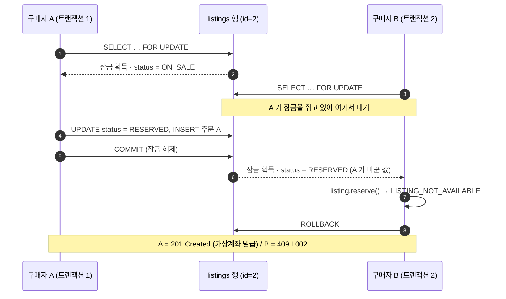

# 두 명이 같은 카드를 동시에 사면, 왜 한 명만 성공하는가

> 1장뿐인 매물에 구매 요청이 동시에 들어올 때 PokeTrade 백엔드가 이중 판매를 막는 과정을 **코드 순서대로** 따라가고,
> 그 결과를 **직접 확인하는 방법 3가지**(GitHub Actions · 로컬 테스트 · API 호출)를 정리한 문서입니다.

**한 줄 요약**: 구매 트랜잭션이 매물 행을 `SELECT … FOR UPDATE`로 잠그고 상태를 확인한 뒤 바꾸기 때문에, 뒤에 온 요청은 앞 트랜잭션이 끝날 때까지 기다렸다가 **이미 바뀐 상태(`RESERVED`)를 읽고 실패**합니다.

---

## 1. 잠금이 없으면 무엇이 문제인가

"상태 확인 → 상태 변경"이 두 단계로 나뉘어 있으면, 두 트랜잭션이 확인 단계를 동시에 통과할 수 있습니다.

```
시간 →
구매자 A:  SELECT status → ON_SALE ──┐          UPDATE RESERVED · INSERT 주문 A
구매자 B:  SELECT status → ON_SALE ──┴─ 둘 다 "살 수 있음" ── UPDATE RESERVED · INSERT 주문 B   ← 이중 판매
```

카드는 1장인데 주문과 가상계좌가 2개 생기고, 두 사람 모두 입금하면 한 명에게는 카드를 줄 수 없습니다.

## 2. 코드 흐름 따라가기

| 순서 | 코드 | 하는 일 |
| --- | --- | --- |
| ① | [`OrderController`](../src/main/java/com/pocket/market/controller/OrderController.java) | `POST /api/orders` 요청을 받아 `OrderService.placeOrder` 호출 (`@Transactional` 시작) |
| ② | [`OrderService.placeOrder` L53–57](../src/main/java/com/pocket/market/service/OrderService.java#L53-L57) | `listingRepository.findByIdForUpdate(listingId)`로 **매물 행 잠금 획득** |
| ③ | [`ListingRepository.findByIdForUpdate` L25–28](../src/main/java/com/pocket/market/repository/ListingRepository.java#L25-L28) | `@Lock(PESSIMISTIC_WRITE)` → SQL `select … from listings where id=? for update` |
| ④ | [`OrderService` L64](../src/main/java/com/pocket/market/service/OrderService.java#L64) → [`Listing.reserve` L101–103](../src/main/java/com/pocket/market/domain/listing/Listing.java#L101-L103) | 상태가 `ON_SALE`이면 `RESERVED`로 전이, 아니면 `LISTING_NOT_AVAILABLE` 예외 |
| ⑤ | [`OrderService` L67](../src/main/java/com/pocket/market/service/OrderService.java#L67) | 주문 생성(금액 스냅샷) + 가상계좌 발급 → 커밋하면서 **잠금 해제** |
| ⑥ | [`ErrorCode` L23](../src/main/java/com/pocket/market/exception/ErrorCode.java#L23) | 실패한 요청은 `409 { "code": "L002" }`로 응답 |

핵심은 **②에서 잠금을 잡은 뒤에 ④에서 상태를 확인**한다는 점입니다. 확인과 변경 사이에 다른 트랜잭션이 끼어들 수 없습니다.

## 3. 두 트랜잭션의 실제 순서



- B는 "먼저 읽고 나중에 실패"하는 것이 아니라, **A의 결과가 확정된 뒤에야 읽습니다.** 그래서 B는 주문 생성이나 가상계좌 발급 같은 작업을 하기 전에 바로 실패합니다.
- 잠금을 기다리다 시간이 초과되면 `PessimisticLockingFailureException`이 발생하고, [`GlobalExceptionHandler` L46](../src/main/java/com/pocket/market/exception/GlobalExceptionHandler.java#L46)이 이를 `409 C002`(잠시 후 다시 시도)로 바꿉니다.

## 4. 직접 확인하는 방법

### ① GitHub Actions에서 보기 (설치 없이)

저장소의 **Actions → CI → 최근 실행 → Summary**에 테스트 결과 표와 아래 줄이 표시됩니다.

```
OrderConcurrencyTest — 20명 동시 주문 → 성공 1건, 실패 19건 (LISTING_NOT_AVAILABLE 19건), 생성된 주문 1건, 매물 상태 RESERVED
PaymentWebhookServiceTest — 같은 웹훅 8건 동시 수신 → PROCESSED 1건, ALREADY_PROCESSED 7건, 예외 0건, 매물 상태 SOLD
```

전체 HTML 테스트 리포트는 같은 실행의 `backend-test-report` 아티팩트로 내려받을 수 있습니다.

### ② 로컬에서 테스트 실행

```bash
./gradlew test --tests "*OrderConcurrencyTest"
```

[`OrderConcurrencyTest`](../src/test/java/com/pocket/market/service/OrderConcurrencyTest.java#L79-L126)가 하는 일은 다음과 같습니다.

1. 판매자 1명, 매물 1건, **서로 다른 구매자 20명**을 만듭니다.
2. 20개 스레드를 `CountDownLatch`로 대기시켰다가 **같은 순간에 출발**시킵니다([L104](../src/test/java/com/pocket/market/service/OrderConcurrencyTest.java#L104)).
3. 성공 1건, 실패 19건(모두 `LISTING_NOT_AVAILABLE`), 주문 행 1개, 매물 `RESERVED`를 검증합니다([L117–126](../src/test/java/com/pocket/market/service/OrderConcurrencyTest.java#L117-L126)).

테스트는 H2 인메모리 DB에서 실행되므로 실제 DB에 영향을 주지 않습니다.

### ③ API로 재현하기

DB 없이 H2로 백엔드를 띄웁니다(데모 매물 8건이 들어갑니다).

```bash
./gradlew bootRun --args='--server.port=8081 --spring.profiles.active=local,h2'
```

다른 터미널에서 **구매자 1과 2가 매물 2번을 동시에** 주문합니다.

```bash
for buyer in 1 2; do
  curl -s -o /dev/null -w "buyer $buyer → HTTP %{http_code}\n" \
    -X POST http://localhost:8081/api/orders \
    -H 'Content-Type: application/json' -H "X-User-Id: $buyer" \
    -d '{"listingId":2}' &
done; wait
```

실제 실행 결과(누가 이길지는 실행마다 다릅니다):

```
buyer 1 → HTTP 201   (PENDING_PAYMENT, 가상계좌 발급)
buyer 2 → HTTP 409   (L002 이미 판매되었거나 거래 진행 중인 매물입니다.)
```

이후 `GET http://localhost:8081/api/listings/2`의 `status`는 `RESERVED`입니다.

## 5. 다른 방법 대신 비관적 락을 고른 이유

| 방법 | 이 상황에서의 판단 |
| --- | --- |
| 낙관적 락 (`@Version`) | 충돌을 커밋 시점에야 알기 때문에, 진 쪽도 주문 생성·가상계좌 발급까지 하고 롤백됩니다. 재고가 1개라 경합 시 성공자는 어차피 한 명뿐입니다. |
| 조건부 UPDATE (`… WHERE status='ON_SALE'`) | 가장 가볍지만 상태 전이 규칙이 엔티티 밖 SQL로 흩어집니다. 유력한 대안입니다. |
| Redis 분산 락 | 단일 DB 안의 정합성 문제에 인프라를 추가하는 셈이고, 락 만료와 트랜잭션 경계를 따로 맞춰야 합니다. |
| **비관적 락** | 진입 시점에 줄을 세우고, 진 쪽은 바뀐 상태를 읽고 즉시 실패합니다. 트랜잭션이 짧아(선점 + 주문 INSERT) 대기도 짧습니다. |

## 6. 같은 원리로 막는 것: 웹훅 중복 반영

PG 입금 웹훅도 같은 방식으로 처리합니다. [`PaymentWebhookService` L46](../src/main/java/com/pocket/market/service/PaymentWebhookService.java#L46)에서 **주문 행을 `FOR UPDATE`로 잠근 뒤** 이미 같은 거래로 결제됐는지 확인합니다([L49–51](../src/main/java/com/pocket/market/service/PaymentWebhookService.java#L49-L51)).

- 그래서 같은 웹훅 8건이 동시에 와도 결제 반영은 1번이고, 나머지 7건은 `ALREADY_PROCESSED`로 응답합니다.
- `orders.pg_transaction_id`의 UNIQUE 제약([`Order` L72–73](../src/main/java/com/pocket/market/domain/order/Order.java#L72-L73))이 마지막 방어선입니다.

자세한 내용은 [README의 웹훅 멱등성 절](../README.md#5-핵심-문제-해결--가상계좌-웹훅-멱등성-보장)을 참고하세요.

## 7. 알려진 한계

- **테스트 DB:** 동시성 테스트는 H2(MySQL 모드)에서 실행됩니다. 운영 DB인 PostgreSQL에서도 `SELECT … FOR UPDATE` 동작은 같지만, Testcontainers로 PostgreSQL 위에서 같은 테스트를 돌리는 것이 다음 단계입니다.
- **잠금 대기 상한:** 대기 상한은 JPA 힌트(`jakarta.persistence.lock.timeout = 3000`)로만 지정되어 있습니다. PostgreSQL에서는 `lock_timeout` 세션 설정으로 DB 수준 상한을 두는 것을 검토하고 있습니다.
